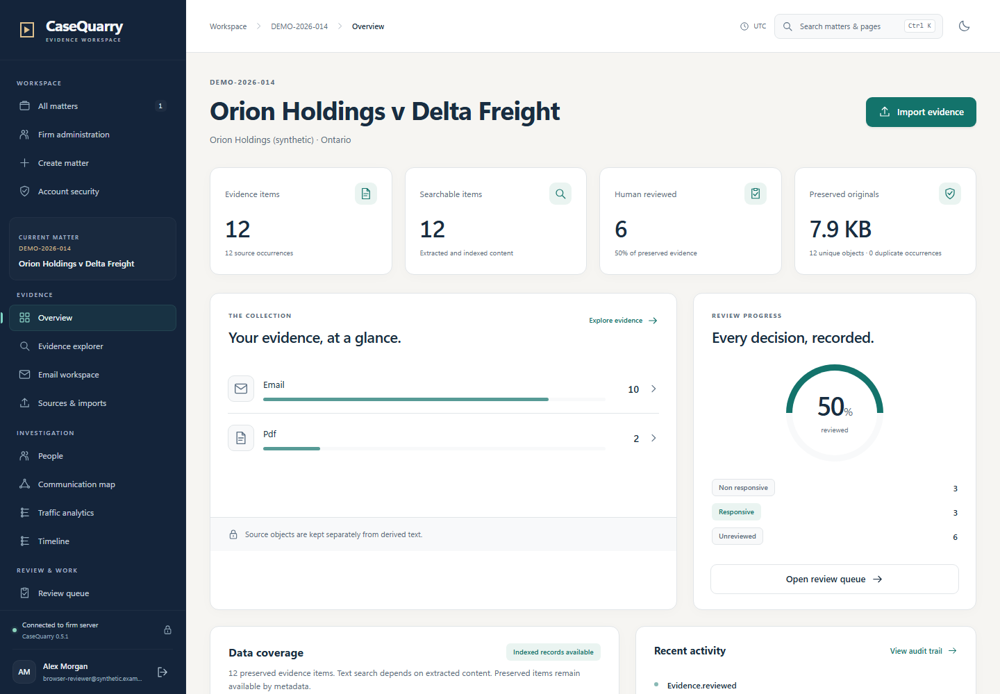
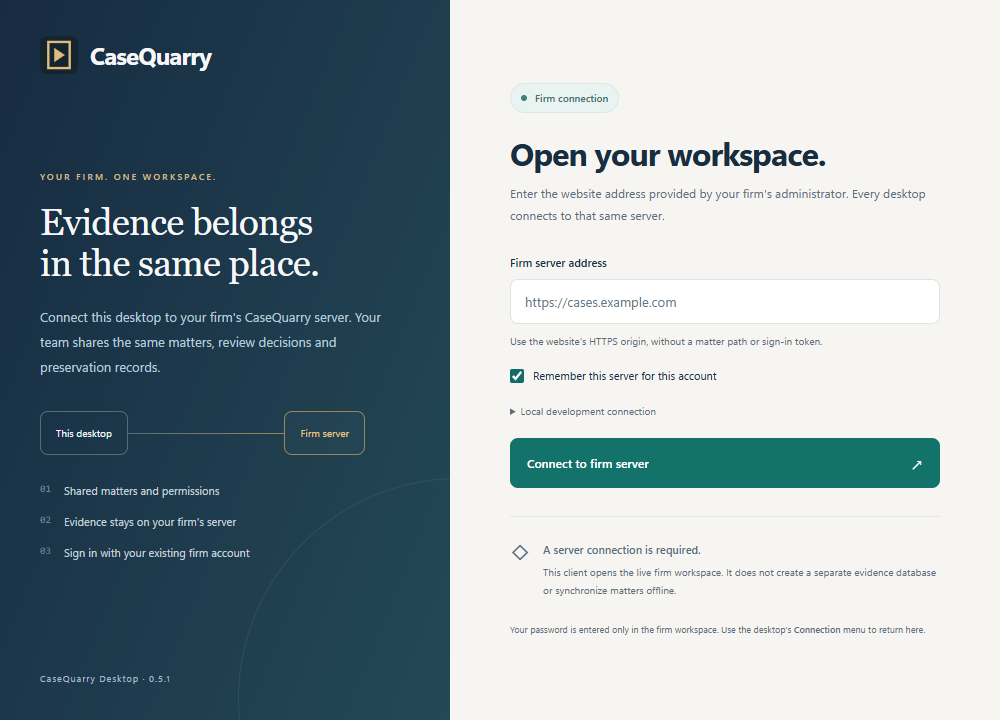

<div align="center">


# CaseQuarry

### Find the facts. Follow the evidence.

A self-hosted evidence workspace for legal teams and investigators.

[](https://github.com/CanerBaba25/CaseQuarry/actions/workflows/release.yml)
[](LICENSE)
[](https://github.com/CanerBaba25/CaseQuarry/releases)

[Download](https://github.com/CanerBaba25/CaseQuarry/releases) · [Quick start](#quick-start) · [Documentation](#documentation) · [Report a bug](https://github.com/CanerBaba25/CaseQuarry/issues)

</div>

Preserve original files, search across messages and documents, follow conversations,
and record human review decisions in one private workspace. CaseQuarry combines
TypeScript/React for the interface, Python for its API and document processing, and
Rust for streaming integrity checks and the native desktop client. PostgreSQL stores
the shared firm data; browsers and desktop clients connect to the same firm server.

> **Release 0.5.1.** Installable Windows, macOS and Linux desktop clients and Windows/Linux web-server
> packages, with PostgreSQL firm sync, conflict-safe task editing and optional provider connections.
> Production capacity and the two-million-email scale target remain unvalidated.



*Actual application view using synthetic records. Counts come from persisted API data.*

## What you can do

| Workflow | Available in 0.5.1 |
|---|---|
| Preserve | SHA-256 originals, source paths, MBOX offsets, duplicates and attachment families |
| Import | Resumable uploads, bounded OCR, durable jobs and retries that preserve extraction history |
| Search | Boolean/phrase/field/date search, exact sender/recipient filters, facets, grouping and pagination |
| Investigate | Email readers, scoped traffic charts, communication maps, threads, timelines and candidate comparisons |
| Review | Versioned decisions, exclusive work assignments, review queues, tags, notes and saved scope snapshots |
| Organize | Matters, members, custodians, sources, issues, task descriptions/deadlines, personal worklists and legal holds |
| Disclose | Irreversible text/PDF redactions, independent approval, sequential Bates numbers and CSV/DAT/OPT loadfiles |
| Export | Metadata and reviewed native ZIP packages, with fresh scope and hash verification |
| Secure | Tenant/matter roles, password/session controls, administrator controls, MFA and audit chains |
| Assist | Optional local or OpenAI/Gemini/Grok/Claude source quotations with verified citations and human review |
| Collaborate | Shared PostgreSQL firm server, automatic refresh and versioned review/task decisions |
| Operate | Browser and native Windows/macOS/Linux clients, server packages, authenticated CLI, integrity tools and backups |

### A clearer daily workspace

The refreshed website uses grouped navigation, readable tables, responsive layouts and
light/dark themes. Switch the matter dashboard between cards and a list, or use the
keyboard command palette to find accessible matters across the server.

**My work** puts your nearest deadlines first. Filter open or in-progress work, then
overdue, upcoming and undated assignments. Open a task to edit its title, description,
status, assignee and due date, or complete authorized tasks directly from the dashboard.
Concurrent saves retain your draft and require conflict resolution before another save.
Counts cover your accessible active
matters, not just the current page. Choose your timezone in account settings for
timestamp displays and deadline classification; entered calendar dates stay intact.
These are team-entered plans rather than calculated court deadlines.

Move between evidence items with **Previous item** and **Next item**, preserving the
visible page order. Unsaved tags or notes block these buttons until saved or cleared.
**Copy source link** captures the exact extraction version and text location;
the recipient still needs matter access. Evidence rows refresh when another connected
workstation saves a review. Listing queries retrieve short snippets without loading
each document's full extracted body and metadata.

### Supported inputs

**Email:** EML, MBOX and bounded Outlook MSG. **Documents:** PDF, TXT, Markdown, HTML, CSV, JSON, DOCX,
XLSX and PPTX. **Images:** PNG, JPEG and TIFF. **Archives:** bounded ZIP imports.

Local Tesseract enables OCR for scanned PDFs and images; missing OCR and extraction
limits remain visible. Install it using the platform guide, then explicitly retry
partial imports to create a new immutable extraction version. Earlier citation links
continue to open their original version.

The CLI inventories and imports local folders and Maildir, and supports explicit,
read-only TLS IMAP acquisition. See [adapter support and limits](docs/ADAPTERS.md).
PST/OST, OAuth mail connectors, media transcription and large-scale ranked search
remain unfinished; live external mail accounts have not been validated.

Redacted productions contain approved derivatives and page images. They require a
different authorized approver and block unsafe privilege, review and integrity states.
Native exports are a separate workflow and can contain original content; see the
[reviewer guide](docs/REVIEWER_GUIDE.md) before choosing an output.

## Download and install

Choose the assets on the [Releases page](https://github.com/CanerBaba25/CaseQuarry/releases):

| Download | Use it for |
|---|---|
| `CaseQuarry_0.5.1_x64-setup.exe` | Install the Windows desktop client on each workstation |
| `CaseQuarry_0.5.1_universal.dmg` | Install on an Apple Silicon or Intel MacBook |
| `CaseQuarry_0.5.1_amd64.deb` | Install the Linux client on Ubuntu 24.04 x64 |
| `casequarry-server-*-windows-x64.zip` | Install the shared web/API server on Windows |
| `casequarry-server-*-linux-x64.zip` | Install the shared web/API server on Linux |
| `*-source.zip` | Build, inspect or modify the application |

SHA-256 sidecars accompany each package. The Windows installer is unsigned and the
Mac app is not notarized; follow the platform guide for the operating system’s
installation approval. Clients use WebView2 on Windows, WKWebView on macOS and system
WebKit on Linux. They connect to the firm server without a separate evidence database.

For a firm, install one server with PostgreSQL and private evidence storage, expose it
through trusted HTTPS, and give staff the same firm URL. Staff can use the browser,
the desktop client, or both. Changes refresh automatically while connected; existing
permissions and conflicting-review checks apply across computers. Evidence remains
on the server. Offline editing and automatic server discovery are not available.



See [server installation](docs/SERVER_INSTALL.md) and [desktop installation](docs/DESKTOP.md)
for prerequisites, setup and trusted certificate configuration. Mac users can follow
the [macOS guide](docs/INSTALL_MACOS.md).

## Quick start

Install [uv](https://docs.astral.sh/uv/getting-started/installation/), Node.js 24 and
PostgreSQL 16. Python 3.12 is selected automatically by the project. The setup command
can initialize a managed local PostgreSQL cluster when its binaries are available;
an existing PostgreSQL server can be configured in `.env` instead.

```shell
git clone https://github.com/CanerBaba25/CaseQuarry.git
cd CaseQuarry
uv sync --locked
uv run python scripts/tasks.py setup
uv run python scripts/tasks.py dev
```

Open **http://127.0.0.1:3000/setup**, enter the generated setup token from your local
`.env`, and choose your administrator password. The API runs on loopback port 8000;
the web app runs on port 3000. Ctrl+C stops both. Evidence persists in `.data`;
the managed PostgreSQL cluster lives outside the source checkout.

For a tagged source download, use the ZIP and SHA-256 sidecar on the
[Releases page](https://github.com/CanerBaba25/CaseQuarry/releases). Extract the ZIP,
open its directory, and run the same commands starting with `uv sync --locked`.

**Upgrading an existing installation:** stop the application, preserve a verified
backup, run `uv sync --locked`, then `uv run python scripts/tasks.py migrate` before restarting.
Version 0.5.0 adds `0007_task_versions` after the existing deadline/timezone migrations;
startup refuses stale schemas. Reload open web/desktop workspaces after upgrading the
server: task edits now require the current task version. See the [task API](docs/TASK_API.md).
Existing SQLite installations require the documented guarded transfer to an empty
PostgreSQL database. Keep the original database and a verified recovery backup.

### Optional Rust tools

With Rust installed:

```shell
cargo build --locked --release -p casequarry-evidence-core
uv run cq ingest inventory-mbox --path path/to/mailbox.mbox
uv run cq evidence hash-file --path path/to/document.pdf
```

The CLI automatically selects the built local engine and supports an explicit
Python fallback. It never downloads a processor while handling evidence.

## Privacy and integrity

- Processing and storage remain on the firm server by default. External model
  processing starts disabled and never runs on import automatically.
- Optional provider keys are encrypted for each user. A firm administrator must approve
  the provider, a matter lead must consent, and the requesting user must confirm each
  external job. Provider API billing and retention terms apply. See [provider setup](docs/CLOUD_AI_GUIDE.md).
- Local Ollama also requires server configuration and matter consent. All adapters
  publish verified source quotations for human review and cannot change evidence decisions.
- Originals are immutable through the application; derived text, citations and export
  manifests are independently hash-checked before use.
- Retried extraction appends a version while preserving the source occurrence and
  review history; historical text is marked as superseded in the reader.
- Search, retrieval, jobs and exports enforce tenant and matter permissions.
- Privilege, review and integrity safeguards restrict native exports, including
  content embedded in parent email or archive families.
- Audit chains detect inconsistency within the stored chain; they are not independent
  signed attestations.

Keep `.env`, `.data`, evidence, secrets and backups private. Use synthetic material
for evaluation and public bug reports.

## Measured results

The recorded **0.1.0** local SQLite run imported **10,000 synthetic emails and 100 mixed documents**:

| Measurement | Recorded result |
|---|---:|
| Preserved occurrences, including attachments/container | 10,902 |
| Exact duplicate occurrences | 199 |
| Failed / unsupported items | 0 / 0 |
| Import time | 163.49 seconds |
| Grouped phrase search p95 | 244.94 ms |
| Peak API + embedded worker memory | 157.20 MiB |

Ten image documents remained partial because OCR was unavailable in that earlier run.
Version 0.2.0 separately verifies real scanned PDF/image OCR and immutable retries;
the larger benchmark has not yet been repeated with the new extraction pipeline.
Percentiles use 15 queries; these results are not a production SLA or a multi-million
capacity claim. See [benchmark scope and method](docs/BENCHMARKS.md).

The complete local Python suite passed **447 tests**, with PostgreSQL checks enabled
and no skipped tests. Coverage includes task conflicts and delayed commits,
timezone boundaries, permission revocation, concurrent uploads, session expiration,
last-lead races, legal holds and upgrades.
The evidence-query improvement preserved **39 complete comparison responses** and
passed **16 focused projection/detail checks** across SQLite and PostgreSQL.
The Rust integrity component passed **11 tests**, and the native desktop client
passed **eight Rust tests**, an actual WebView2 runtime diagnostic and three isolated
install/launch/uninstall checks. Real-browser checks cover evidence import/search,
review and production approvals, shared task refresh, account isolation, provider
controls, the redesigned dashboard, timezone persistence and 375px mobile views.
Native release checks install and launch the Ubuntu package and exercise the same
universal Mac app on Intel and Apple Silicon runners.
Controlled HTTP responses exercise all
four provider transports; live vendor accounts and model quality remain unvalidated.
GitHub verifies linting, PostgreSQL migrations and Python/web/Rust/desktop builds.
Verification suites and synthetic QA harnesses are maintained locally and excluded
from the public source distribution.

## Documentation

| Audience | Guides |
|---|---|
| Install | [Firm server](docs/SERVER_INSTALL.md), [Desktop client](docs/DESKTOP.md), [Windows](docs/INSTALL_WINDOWS.md), [macOS](docs/INSTALL_MACOS.md), [Linux](docs/INSTALL_LINUX.md) |
| Review evidence | [Reviewer guide](docs/REVIEWER_GUIDE.md), [CLI reference](docs/CLI_REFERENCE.md), [Task API](docs/TASK_API.md) |
| Acquire files and mail | [Supported adapters and limits](docs/ADAPTERS.md) |
| Administer | [Administrator guide](docs/ADMIN_GUIDE.md), [Backup and recovery](docs/BACKUP_RECOVERY.md) |
| Assess controls | [Threat model](docs/THREAT_MODEL.md), [Data handling](docs/DATA_HANDLING.md), [Evidence integrity](docs/EVIDENCE_INTEGRITY.md) |
| Assess optional models | [Provider connections](docs/CLOUD_AI_GUIDE.md), [Analysis safety and runtime policy](docs/AI_SAFETY.md) |
| Understand the code | [Architecture](docs/ARCHITECTURE.md), [Release notes](RELEASE_NOTES.md) |

PostgreSQL workflows are checked against a real server. Container configuration is
included; Docker runtime operation, production recovery, real-model quality and
staged 100k/1m/2m capacity remain unverified.

## Contributing and licensing

Bug reports and focused pull requests are welcome. Read [CONTRIBUTING.md](CONTRIBUTING.md)
and use [SECURITY.md](SECURITY.md) for sensitive vulnerabilities.

CaseQuarry code is licensed under [Apache 2.0](LICENSE). Independent forks,
modification, redistribution and commercial use are permitted under its terms.
Dependencies retain their [own licenses](THIRD_PARTY_NOTICES.md).

Trademark rights are separate: see the [branding policy](docs/BRAND_POLICY.md) and
[preliminary name check](docs/NAME_CHECK.md). No registration or official registry
clearance is claimed.

CaseQuarry supports professional judgment. It does not provide legal advice, decide
privilege automatically, guarantee admissibility or claim regulatory certification.
