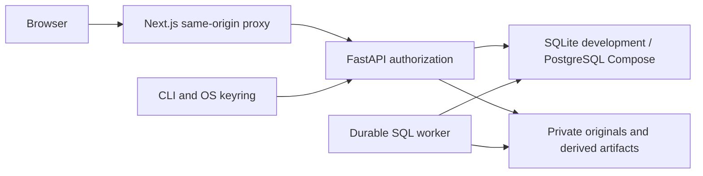

# Architecture and release boundary

The 0.1 slice uses Next.js/React/TypeScript, FastAPI/Pydantic, SQLAlchemy with migrations, private filesystem storage and a durable SQL-backed import queue. Local development uses SQLite; Compose selects PostgreSQL 16 and a separate worker. The browser and CLI use the same versioned authenticated `/api/v1` API.

Evidence storage is private; downloads go through authorization and hash verification. Metadata, source occurrences, derived text, review decisions and audit events are separate from original bytes. Deduplication must retain source occurrences and family relationships. Extraction failures retain originals and remain visible in coverage.

Search currently uses scoped SQL keyword/metadata queries and server aggregations. OpenSearch, vector search, RabbitMQ/Celery, enterprise OIDC, external mailbox connectors and multi-million-message capacity are not claimed by this stack. Pagination and streaming are design safeguards; actual throughput and capacity require benchmarks.

AI and remote transmission are disabled by default. Optional local analysis must validate citations against retrieved, authorized text spans and must not change human review decisions. Unavailable adapters/models return explicit errors.

`apps/api/casequarry` contains domain/API/worker code; `apps/cli/casequarry_cli` is the public API client; `apps/web` is the interface; `migrations` tracks schema; `scripts` contains portable setup, fixture, benchmark and source-release utilities. Application-level preservation and hash-chain auditing are not tamper-proof against a machine administrator.

Version 0.1.0 is a development slice. Confidential deployment, final licensing, redaction/production interoperability, backup recovery assurance, practitioner QA and larger capacity claims remain release gates until their exact tests and reviews are recorded.
