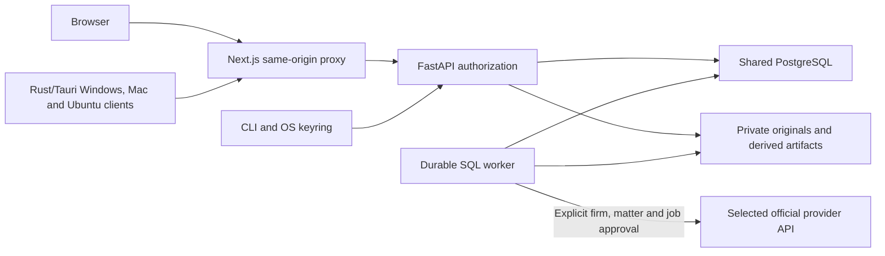

# Architecture and release boundary

The application uses Next.js/React/TypeScript, FastAPI/Pydantic, SQLAlchemy with migrations, private filesystem storage and a durable SQL-backed import queue. PostgreSQL 16 is the normal shared database, including managed local development. SQLite remains available for explicit local QA and guarded legacy recovery. Browsers, the Rust/Tauri desktop client and the CLI use the same versioned authenticated `/api/v1` API.

Evidence storage is private; downloads go through authorization and hash verification. Metadata, source occurrences, derived text, review decisions and audit events are separate from original bytes. Deduplication must retain source occurrences and family relationships. Extraction failures retain originals and remain visible in coverage.

Search currently uses scoped SQL keyword/metadata queries and server aggregations. OpenSearch, vector search, RabbitMQ/Celery, enterprise OIDC, Microsoft/Google OAuth collection and multi-million-message capacity are not claimed by this stack. Explicit read-only IMAPS/Maildir acquisition is available through the CLI; validation used a synthetic TLS loopback mailbox. Pagination and streaming are design safeguards; actual throughput and capacity require benchmarks.

Model processing and remote transmission are disabled by default. Optional local Ollama and external OpenAI/Gemini/Grok/Claude/Kimi adapters validate exact quotations against authorized source spans and cannot change human review decisions. External requests use encrypted user-owned keys and require firm policy, matter consent and explicit per-job confirmation; fixed official HTTPS endpoints and bounded input/output prevent arbitrary URL or tool execution. Live vendor compatibility remains unvalidated.

Committed audit mutations increment tenant/catalog or matter revision signals in the same transaction. Browser and desktop views poll authorized revision metadata every five seconds while visible, re-fetch changed scopes and clear revoked matter views. Read audits do not cause refresh loops. Import heartbeat metadata provides progress updates. Shared PostgreSQL remains authoritative; clients have no offline evidence replica or queued offline writes. The personal worklist separately refreshes current-user active assignments.

`apps/api/casequarry` contains domain/API/worker code; `apps/cli/casequarry_cli` is the public API client; `apps/web` is the shared interface; `apps/desktop` is the isolated Windows/macOS/Ubuntu client with its own Cargo workspace; `migrations` tracks schema. Public `scripts` contains setup, backup, notices, package construction and required package verification utilities. Local test/fixture/benchmark/browser harnesses are excluded from source distributions. Application-level preservation and hash-chain auditing are not tamper-proof against a machine administrator.

PDF text/OCR and MSG extraction use isolated fixed-command subprocesses with bounded output and timeouts. Import claims use a fenced owner nonce, a renewable lease and cooperative record quotas; a dedicated import slot allows exports and production work to progress during slow extraction. Parsing occurs outside SQL writer transactions and authorization is checked before publication. See [adapter limits and acquisition behavior](ADAPTERS.md).

Shipped API launch commands disable Uvicorn proxy-header rewriting explicitly. General rate limits use verified tenant/user identity; anonymous and sign-in limits use the actual transport peer. Forwarded headers do not establish identity. A future production reverse-proxy deployment must configure and validate its trusted network boundary explicitly before enabling forwarded-header handling.

The optional Rust evidence core provides bounded streaming SHA-256, native-package manifest verification and MBOX preflight. The CLI invokes a fixed locally built binary through an operation allowlist without a shell; Python fallbacks keep these local diagnostics available when the binary is not built. It does not replace server-side matter authorization or MIME/document parsing.

The published 0.1.0 baseline and working reviewer extensions use Apache-2.0. Confidential deployment, production recovery/redaction interoperability, practitioner QA and larger capacity claims remain release gates until their exact tests and reviews are recorded. The local 10k SQLite trial is documented in [benchmarks](BENCHMARKS.md); it proves its recorded scope only and predates the isolated parser extensions.
